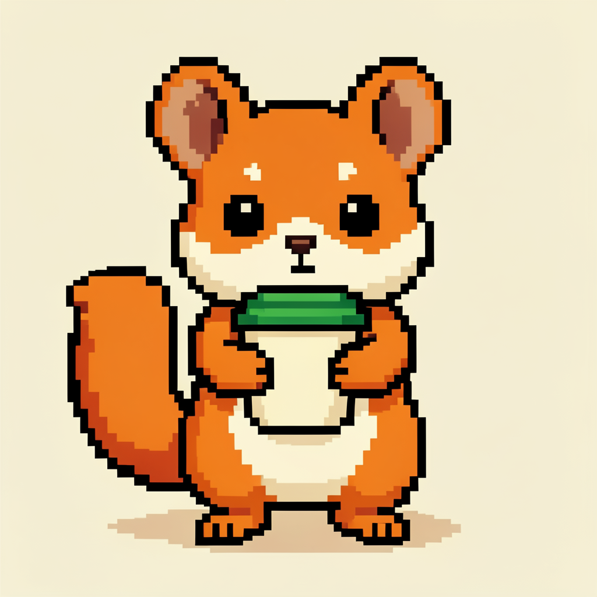
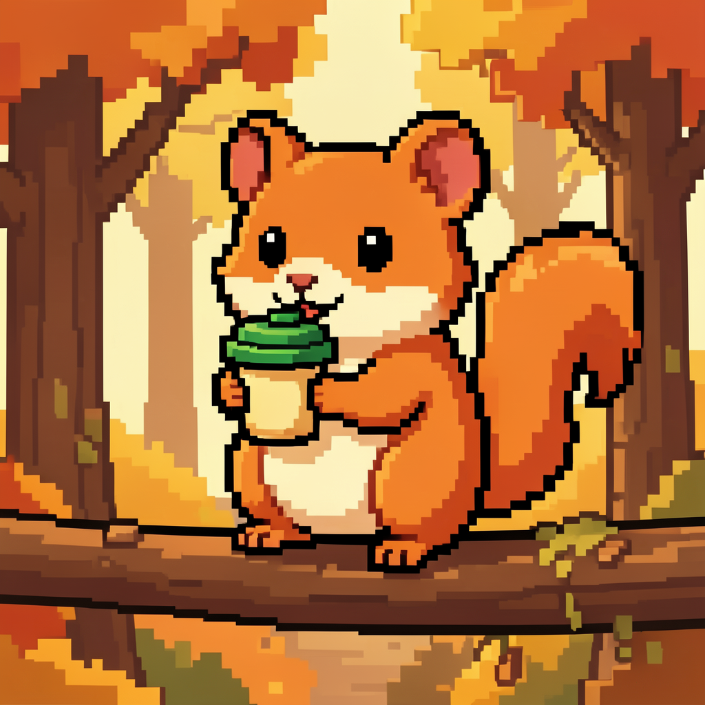
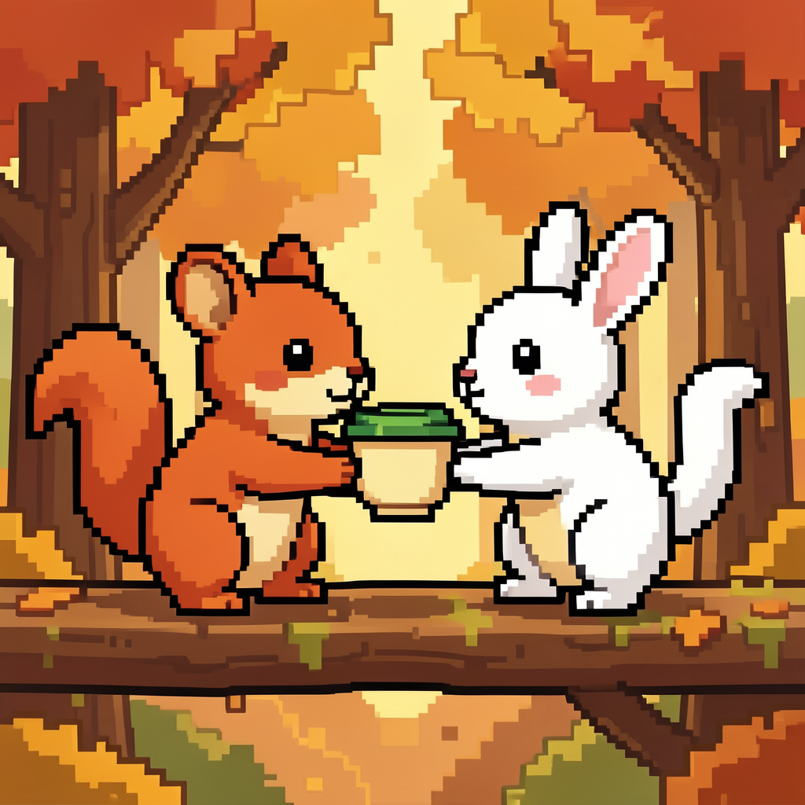
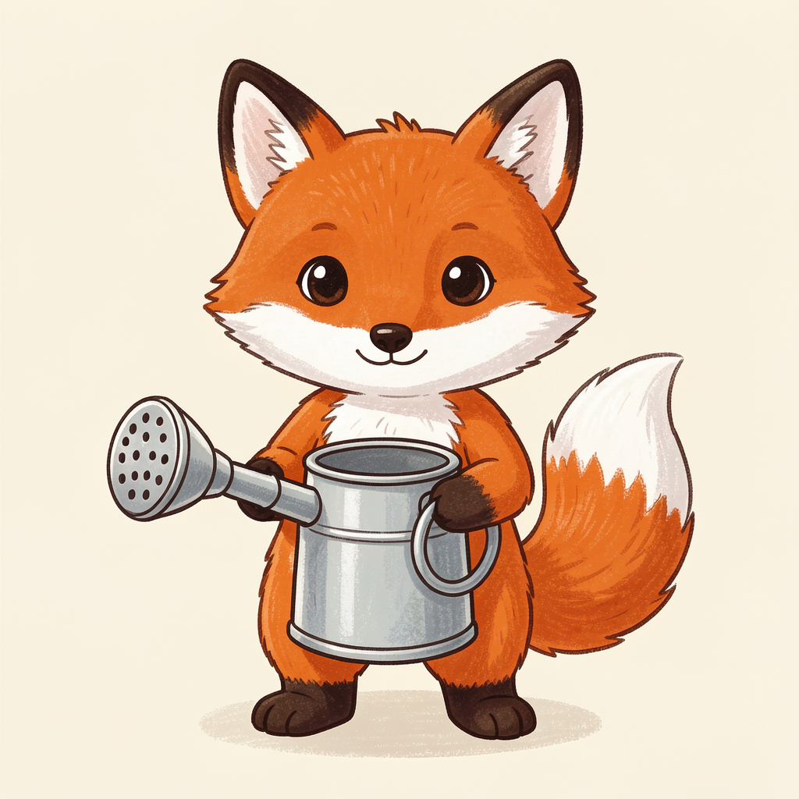
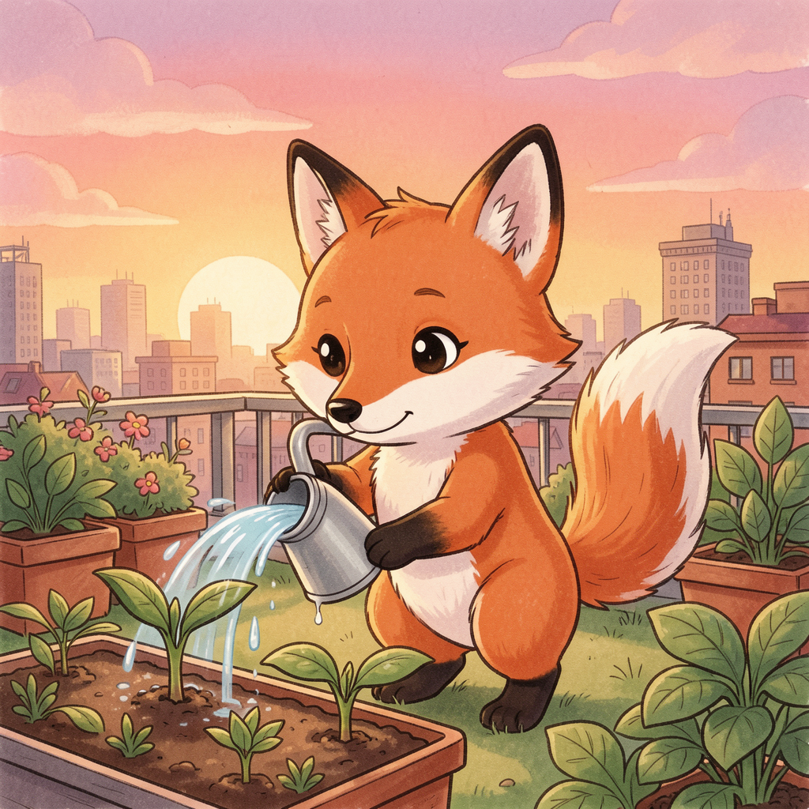
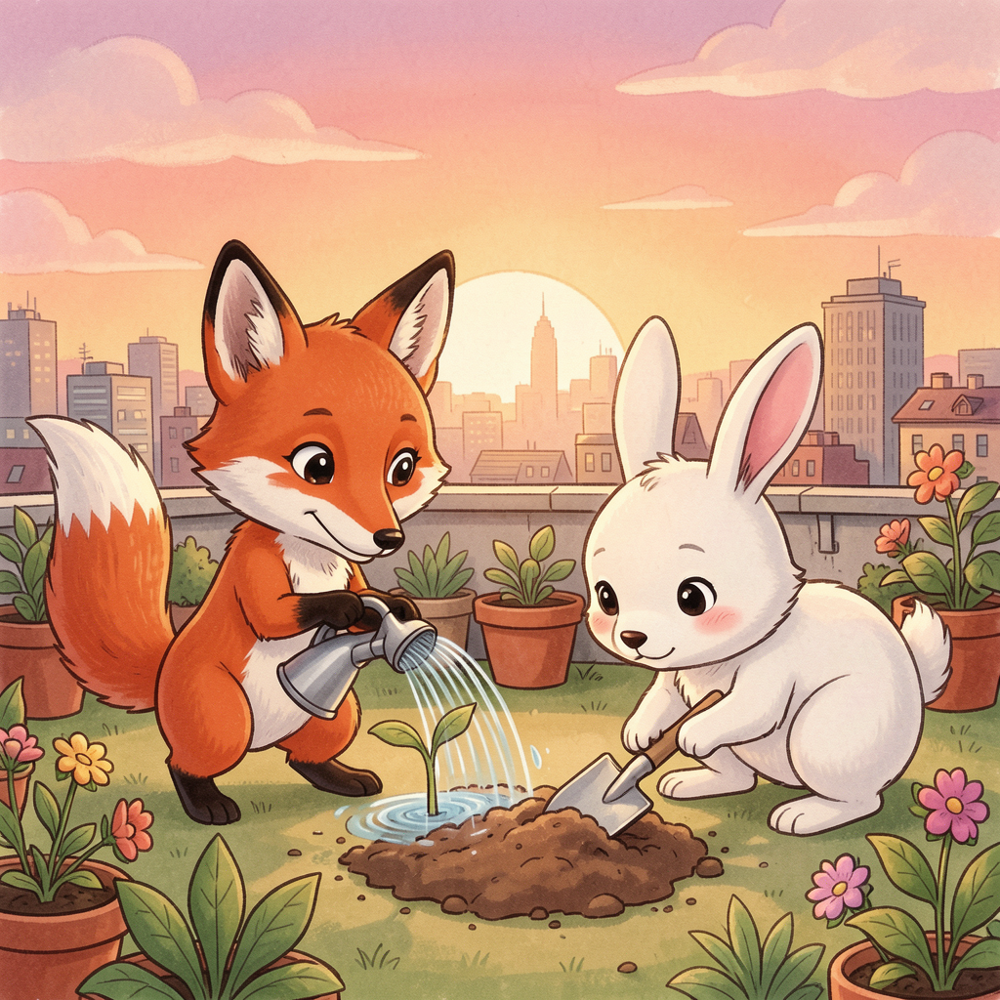
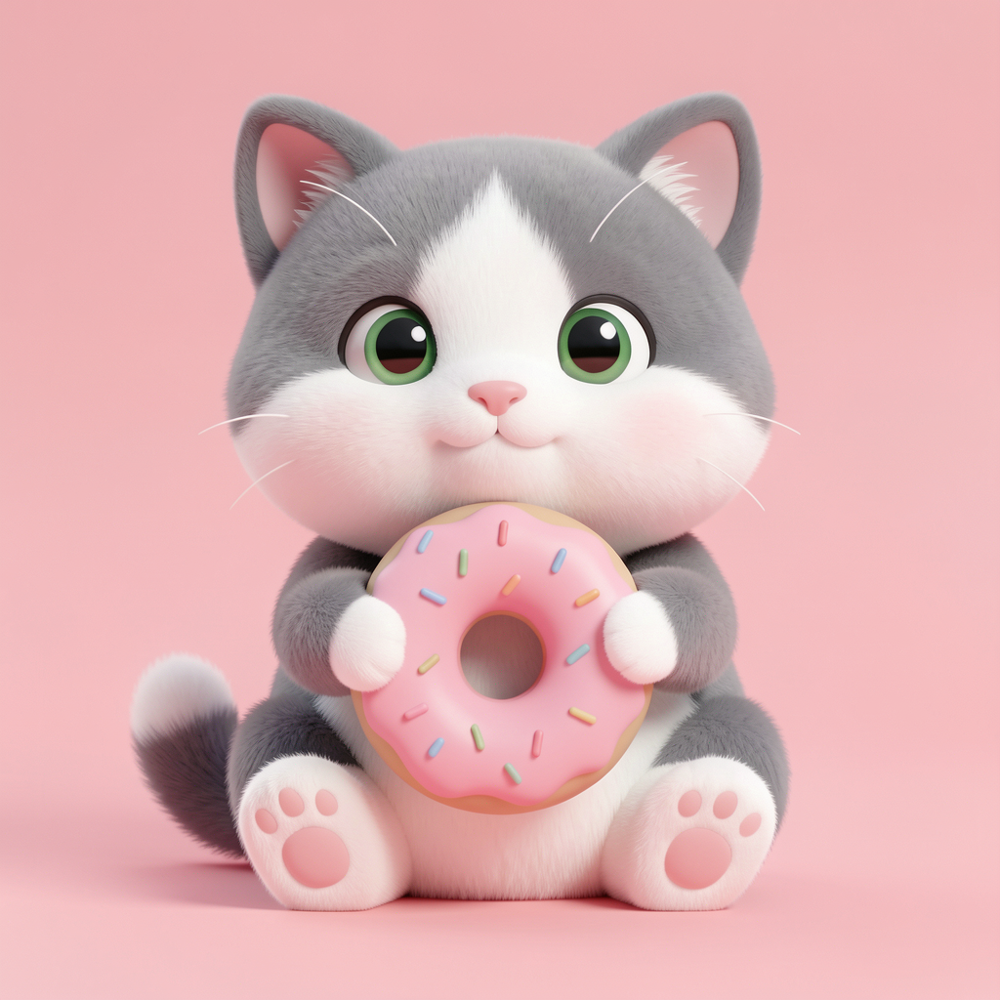
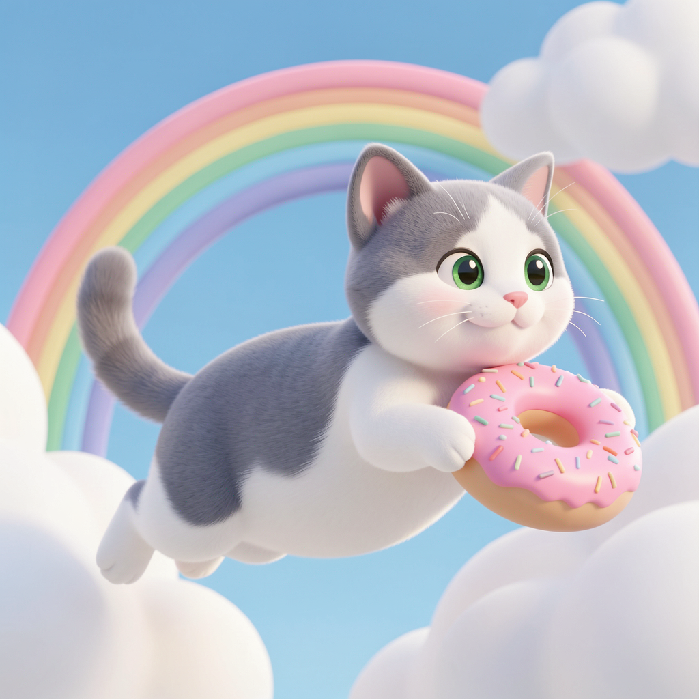
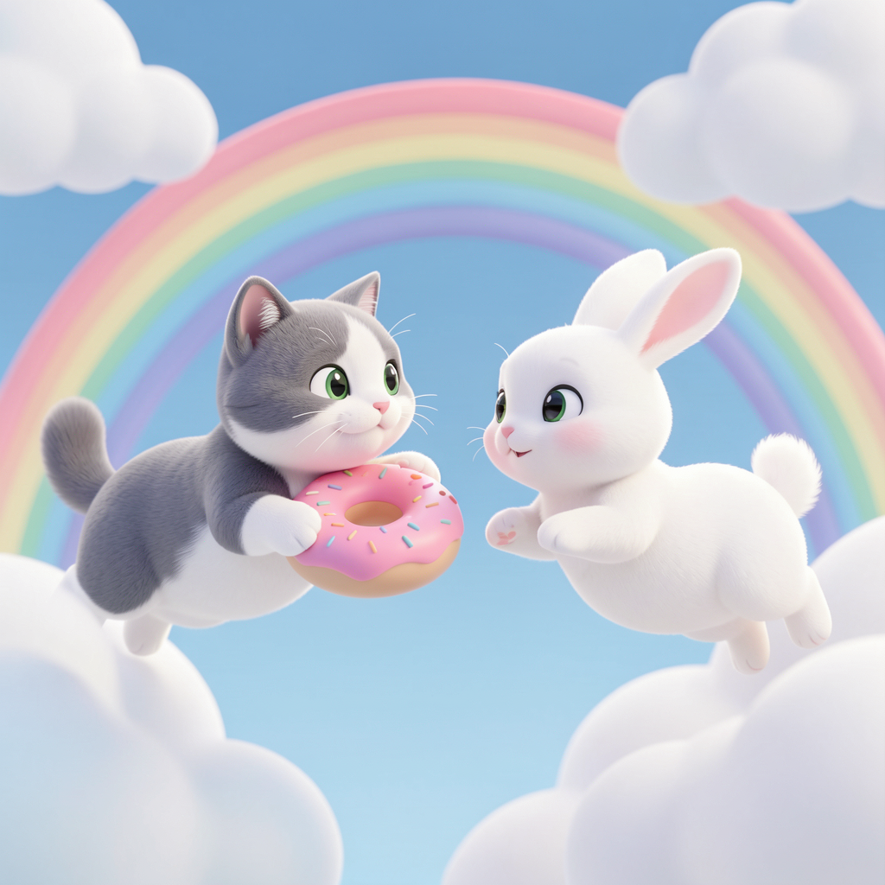
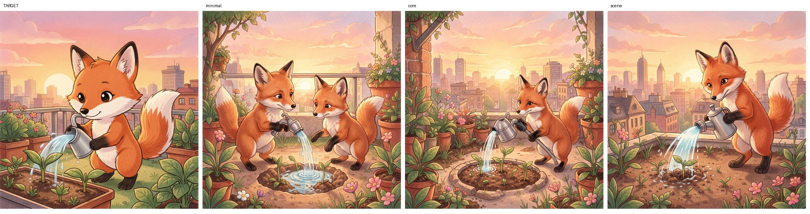

# AI SLOP STOP CHALLENGE

목표 이미지를 프롬프트로 재현하고, 생성·판정의 자원 소비를 자전거 발전 체험과 영수증으로 연결한 오프라인 캠페인입니다.

**실제 캠페인 진행 완료 · 2026-11-13 운영자 확인**

[챌린지 웹](https://ai-slop-stop.vercel.app/) · [자전거 계측 저장소](https://github.com/fotrhh22/ai-slop-bike-calculation)

## 체험 흐름

목표 관찰 → 프롬프트 입력 → 생성·판정 → 사용량/에너지 기록 → 참가자 코드 → 자전거 발전 체험 → 최종 영수증 출력.

Google의 [Say What You See](https://artsandculture.google.com/experiment/say-what-you-see/jwG3m7wQShZngw)를 프롬프트 학습 형식의 레퍼런스로 삼고 자원 계측·오프라인 체험을 추가했습니다.

## 구성·사용 서비스

| 구성 | 기술·서비스 |
| --- | --- |
| 웹·API | React·TypeScript·Vite / FastAPI / Vercel·Render |
| 데이터 | Supabase PostgreSQL·Storage |
| 생성·판정 | Gemini API 또는 RunPod의 Klein 9B NF4·Qwen3.5-4B |
| 보조 유사도 | 선택적 Mac CLIP 워커 |
| 계측·현장 연계 | Zeus·NVML / 별도 자전거 측정소 |
| 인쇄 | Pillow·Atkinson·ESC/POS·CUPS·PT-210 |

GPU 실행 에너지, Gemini 토큰, 자전거 실측/환산값은 구분해 기록합니다. 미계측 값을 0으로 취급하거나 서비스 전체 에너지로 확대하지 않습니다.

## 목표 이미지 9개: 선정 원리와 세션 로직

참가자가 데스크톱에서 임의 이미지를 업로드하던 흐름을 **테마 3개 × 난이도 3개로 구성한 고정 목표 9개 선택**으로 바꿨습니다. 같은 테마 안에서는 캐릭터·화풍·핵심 물건을 유지하고, 묘사해야 할 배경·행동·관계를 단계적으로 추가합니다. 목표는 문장을 무조건 길게 쓰는 것이 아니라 **이미지에서 중요한 대상을 관찰하고, 물건의 속성과 행동의 관계를 필요한 만큼 표현하는 것**입니다.

### 테마와 난이도 기준

| 테마 | 고정 캐릭터·화풍 | 고정 물건 | 하 | 중 | 상 |
|---|---|---|---|---|---|
| A | 주황 아기 다람쥐·픽셀아트 | 초록 뚜껑의 크림색 컵 | 정면에서 컵 들기 | 가을 숲 나무다리에서 컵으로 마시기 | 같은 다리에서 흰 토끼에게 컵 건네기 |
| B | 주황 아기 여우·따뜻한 2D 동화책 | 은색 물뿌리개 | 정면에서 물뿌리개 들기 | 도시 노을의 옥상 텃밭에서 새싹에 물 주기 | 같은 텃밭에서 여우는 물을 주고 흰 토끼는 삽으로 흙 파기 |
| C | 회색·흰색 아기 고양이·부드러운 3D | 분홍색 도넛 | 정면으로 앉아 도넛 들기 | 무지개 하늘에서 도넛을 들고 수평 비행 | 같은 하늘에서 날아다니는 흰 토끼와 마주치기 |

- **하:** 단색 배경＋캐릭터 한 마리＋물건 들기. A·B는 정면으로 서 있고 C는 정면으로 앉습니다.
- **중:** 같은 캐릭터·물건＋배경 등장＋구체적인 행동.
- **상:** 중의 배경·물건을 유지하면서 다른 캐릭터와 상호작용하거나 역할을 나눕니다.

난이도는 단순한 소품 개수가 아니라 **묘사할 조건과 관계의 복잡도**로 설계했습니다. B중·상에 있던 모자·멜빵바지는 난이도 차이에 불필요한 복장 조건이 더해지지 않도록 제거했습니다. C는 도넛을 유지하면서 탈것 없이 비행하며, 앞발을 치켜드는 자세나 아이싱·개수를 별도 정답 조건으로 요구하지 않습니다. 세 단계는 같은 이미지에 객체를 기계적으로 합성한 것이 아니라, 동일한 정체성과 핵심 물건을 유지하도록 개별 제작·검수한 장면입니다. 이 설계 난이도는 참가자 성공률로 보정한 통계적 난이도와는 구분합니다.

현재 사용하는 목표 이미지입니다. 가로는 **하 → 중 → 상**, 세로는 **A → B → C**입니다.

| 테마 | 하 | 중 | 상 |
|---|---|---|---|
| A · 다람쥐 |  |  |  |
| B · 여우 |  |  |  |
| C · 고양이 |  |  |  |

### 선택한 목표가 저장되는 과정

```text
새 세션
  → 모델 선택 팝업: Gemini 기본 선택 / GPU 프로필 준비 상태 확인
  → 이미지 선택 팝업: A·B·C 테마별 하·중·상 9개 표시
  → 이미지 클릭: 선택한 원본 PNG를 data URL로 읽기
  → POST /api/challenges { target_image, profile_id }
  → API: 이미지 검증 → Supabase Storage의 challenge-targets에 원본 저장
  → challenges: UUID·목표 경로·접근 토큰 해시·모델 프로필 스냅샷 저장
  → 채팅의 고정 목표 패널: 선택 이미지·제목·힌트 표시
  → 생성 결과는 세션에 저장된 같은 목표를 기준으로 판정
```

선택한 목표는 세션 동안 고정합니다. 변경하려면 새 세션에서 모델과 이미지를 다시 선택합니다. 이미지나 모델 연결·세션 저장이 실패하면 선택 화면에서 오류를 확인하고 다시 시도할 수 있으며, 저장 중에는 중복 선택을 막습니다. 목표 이미지 원본과 모델 스냅샷은 서버에 저장하지만, `A-LOW` 같은 카탈로그 ID와 힌트 연결은 현재 프런트엔드 세션에 유지됩니다. 이를 별도의 DB 콘텐츠 카탈로그나 새로고침 후 세션 복구 기능으로 설명하지 않습니다.

구현: [목표·힌트 데이터](web/src/data/challengeTargets.ts), [모델/이미지 선택 팝업](web/src/components/TargetImagePicker.tsx), [목표·힌트 패널](web/src/components/TargetImagePanel.tsx), [원본 이미지 출처](web/public/challenge-targets/sources.json). 상세 흐름은 [고정 목표 이미지 안내](docs/CURATED_CHALLENGE_TARGETS.md)를 참고하세요.

### 테마 공통 힌트와 사진별 개별 힌트

힌트는 질문이 아니라 **참가자가 프롬프트에 바로 사용할 수 있는 단어·짧은 구문**으로 제공합니다. 기획상 공통 힌트는 화풍·캐릭터·고정 물건, 개별 힌트는 해당 장면의 자세·행동·배경·관계입니다. 현재 UI에서는 이를 `그림체`, `캐릭터·물건·행동`, `배경·구도` 세 그룹으로 묶어 펼쳐볼 수 있습니다.

| 테마 | 테마별 공통 힌트 |
|---|---|
| A · 다람쥐 | `픽셀아트` · `주황 아기 다람쥐` · `초록 뚜껑의 크림색 컵` |
| B · 여우 | `따뜻한 2D 동화책 그림` · `주황 아기 여우` · `은색 물뿌리개` |
| C · 고양이 | `부드러운 3D` · `회색·흰색 아기 고양이` · `분홍색 도넛` |

| 목표 | 사진별 개별 힌트 |
|---|---|
| A하 | `정면으로 서 있기` · `컵 들기` · `단색 크림색 배경` |
| A중 | `컵을 입에 대고 마시기` · `가을 숲` · `나무다리 위` |
| A상 | `왼쪽 다람쥐·오른쪽 흰 토끼` · `컵을 건네고 받기` · `가을 숲의 나무다리` |
| B하 | `정면으로 서 있기` · `물뿌리개를 가만히 들기` · `단색 크림색 배경` |
| B중 | `여우 한 마리` · `물뿌리개를 직접 들고 기울이기` · `주둥이에서 새싹의 흙으로 물 붓기` · `도시 노을의 옥상 텃밭` |
| B상 | `왼쪽 여우·오른쪽 흰 토끼` · `여우는 새싹에 물 주기` · `토끼는 작은 삽으로 흙 파기` · `도시 노을의 옥상 텃밭` |
| C하 | `정면으로 앉아 있기` · `도넛 들기` · `단색 연분홍 배경` |
| C중 | `도넛을 들고 오른쪽으로 수평 비행` · `파란 하늘` · `파스텔 구름과 무지개` |
| C상 | `왼쪽 고양이·오른쪽 흰 토끼` · `고양이는 도넛 들기` · `두 동물이 날면서 서로 마주 보기` · `파란 하늘·구름·무지개` |

위 표는 콘텐츠 설계·검수에서 정리한 힌트이며 UI에는 일부 표현을 합쳐 표시합니다. 명사만 나열하는 것보다 **누가 어떤 물건을 가지고 무엇을 하는지**를 연결하도록 안내합니다. 힌트는 관찰을 돕는 표현이며 특정 단어를 그대로 입력해야만 통과하는 키워드 채점 규칙은 아닙니다.

### 개별 힌트를 선정한 검증 과정

목표 제작용 상세 프롬프트와 참가자에게 제공할 힌트는 분리했습니다. 앱과 분리된 제작 환경에서 **Klein 9B NF4, RTX 5090 1장, 1024×1024, 4스텝**으로 생성 이미지를 비교하고, 실제 결과에 남는 요소와 사라지는 요소를 관찰해 힌트를 보완했습니다.

| 단계 | 진행한 작업 | 힌트 선정에 사용한 근거 |
|---|---|---|
| 1. 목표 제작·검수 | 테마별 캐릭터·화풍·물건을 유지하면서 목표 9장을 생성하고, 배경·자세·객체 수·관계를 확인 | 프롬프트에 쓴 내용보다 실제 목표 이미지에 보이는 조건을 우선 |
| 2. 사용자 문장＋힌트 비교 | 목표별로 임의 사용자 문장을 고정하고 화풍·내용·장면 힌트를 단계적으로 추가하는 36장 비교를 여러 설계 버전에서 수행 | 어떤 종류의 정보가 추가될 때 화풍·색·소품·행동이 구체화되는지 관찰 |
| 3. 필수 묘사 탐색 | 성공 문장에서 조건 하나씩 제거 → 함께 생략한 조합 확인 → 통과 후보의 추가 시드 확인 | 생략해도 유지되는 보조 표현과, 빠졌을 때 핵심이 무너지는 묘사를 구분 |
| 4. 현재 목표의 간단 문장 비교 | 최신 목표 9장에 각각 `핵심만 / 속성 보강 / 장면·관계 보강` 3개 문장을 작성해 27장 생성. 목표별 세 후보는 같은 시드·설정 사용 | 문장 길이만이 아니라 고정 물건·행동·구도의 유지 여부로 후보 선택 |
| 5. B 목표 수정 후 재검증 | B중·상의 모자·멜빵바지를 삭제한 새 목표 2장을 먼저 생성하고 해당 목표로 간단 후보 6장을 교체 | 이전 복장·목표의 검증 결과가 새 목표의 근거로 섞이지 않도록 관리 |
| 6. B중 관계 묘사 보완 | `한 마리` → `손잡이를 잡고 기울이기` → `주둥이에서 새싹의 흙으로 물이 떨어짐`의 세 후보를 추가 생성 | 물건 명사뿐 아니라 소유·조작·물줄기 출발점/도착점을 힌트로 명시 |

36장 힌트 비교와 조건 제거 실험은 **목표가 변경되기 전 버전도 포함한 제작 과정**입니다. 현재 9장 전체가 같은 조건으로 두 시드 검증을 통과했다는 뜻은 아닙니다. 현재 비교 자료는 최초 27장 중 B중·상 6장을 교체하고, 다시 B중 3장을 보완한 결과로 구성됩니다. 즉 표시된 비교 27장은 기존 21장＋복장 없는 B상 3장＋관계 묘사를 보완한 B중 3장입니다. 과거 실패와 원본 기록은 별도로 보존했습니다.

비교 평가는 기존 운영 판정 프롬프트의 `subject`·`composition`·`color`·`background` 기준을 적용한 **육안 평가**입니다. 주요 피사체 또는 구도의 핵심이 어긋나면 FAIL로 보고, 색·배경 차이는 구체적으로 기록했습니다. 네 항목이 모두 MATCH여야 한다는 추가 규칙은 두지 않았습니다. 이 콘텐츠 제작 비교에서 **Qwen/Gemini 판정 모델을 실제 호출해 얻은 결과와는 구분**하며, 시간·Zeus GPU 에너지·VRAM·시드·프롬프트·원본 이미지도 함께 기록했습니다.

| 관찰한 실패·개선 | 힌트에 반영한 내용 |
|---|---|
| A에서 `초록 뚜껑 컵`만 쓰면 컵 전체가 초록색이 되거나 다른 컵으로 바뀜 | `초록 뚜껑의 크림색 컵`을 한 묶음으로 제공 |
| B하에서 물뿌리개가 분무기처럼 되거나 물을 분사함 | 원예용 물뿌리개 형태와 `가만히 들기`를 목표 제작에서 보완. 간단 후보의 재현 안정성은 보류 |
| B중에서 여우가 두 마리로 늘거나 물뿌리개가 고정 수도꼭지로 바뀜 | `여우 한 마리`만으로 해결되지 않아 `직접 들고 기울이기`와 물줄기의 출발점·도착점을 추가 |
| B중 보완 ②는 도구·행동을 재현했지만 불필요한 막대 추가, ③은 한 마리·물뿌리개·물줄기 관계를 재현 | ③을 해당 시드의 추천 문장으로 선택. 모든 시드의 성공을 보장하는 규칙으로 취급하지 않음 |
| B상은 여우 물 주기와 토끼 삽질이 뒤섞일 수 있음 | 좌우 위치와 `여우는 물 주기 / 토끼는 삽질`의 역할 분담을 명시 |
| C중에서 비행 자세를 짧게 쓰면 몸이 세워짐 | `몸을 수평으로 뻗어 날아가기`를 장면 힌트에 유지 |
| C상 간단 후보 세 개 모두 도넛이 목·몸에 끼는 오류 | `고양이는 도넛 들기`로 소유 관계를 안내하되, 해결이 검증된 문장이라고 주장하지 않고 추천 보류 기록 유지 |

B중 보완의 실제 비교입니다. 왼쪽부터 **고정 목표 → 후보 ① → 후보 ② → 후보 ③**이며, ①은 여우가 두 마리, ②는 불필요한 막대, ③은 핵심 물 주기 관계를 재현했습니다.



전체 비교: [A 목표·후보](docs/assets/target-hint-validation/a-comparison.jpg), [B 목표·후보 — 최신 보완 반영](docs/assets/target-hint-validation/b-comparison.jpg), [C 목표·후보](docs/assets/target-hint-validation/c-comparison.jpg), [27개 프롬프트·육안 평가·계측 CSV](docs/assets/target-hint-validation/comparison-results.csv).

**검증의 범위:** 간단 후보의 실패를 새로운 정답 조건으로 바꾸지 않았고, 실제 사용자 대상 힌트 효과·성공률 개선을 입증한 실험으로 설명하지 않습니다. 이 기록은 관측한 생성 오류를 바탕으로 콘텐츠와 안내 표현을 다듬은 제작 검증이며, 참가자 대상 교육 효과나 모든 시드의 안정성은 별도 평가 대상입니다.

## 문서

- [실행·모델·계측·운영 기준](docs/current/OPERATIONS.md)
- [Atkinson 선택 과정](docs/current/PRINT_DITHERING_DECISION.md)
- [실제 캠페인 결과](docs/campaign-20261112/README.md)
- [프린터 운영](printer_bridge/README.md) · [DB 설정](supabase/README.md)
- [문서 목록·과거 기록](docs/README.md)

이 저장소는 캠페인용이며 앱인토스 배포 앱 AIMI와 별개입니다. 캠페인의 Vercel 웹은 종료된 AIMI 웹 데모와 다른 서비스입니다.
