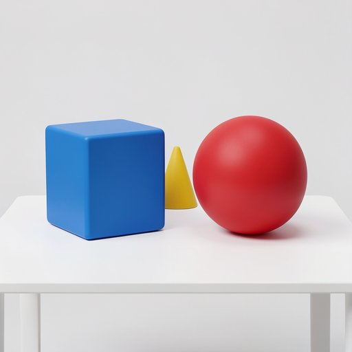
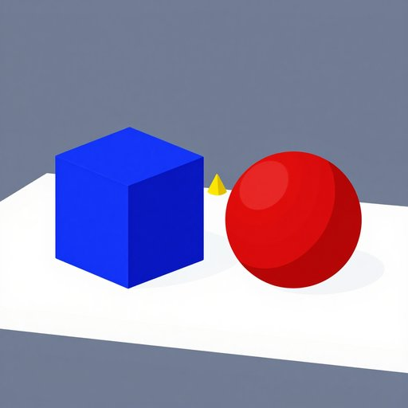

# 생성 모델·판정·CLIP 검증 결과

2026-11-05 기록. 생성 후보와 판정 비교는 RTX 5090 1장에서 수행했다. 아래 수치는 저장된 실측 결과이며 웹 전체 응답 시간이 아니다. 자전거 발전·FNB58 수신·참가자 연계·PT-210 실제 출력 등 캠페인 기술 검증은 운영자 확인으로 완료됐다. 이 문서의 제한은 해당 기능의 미완료가 아니라 모델 비교 표본·측정 범위에 관한 것이다.

## 생성 후보 비교

동일 한국어 프롬프트 5개(사과, 악어 비행기, 공간 배치, 오리, 한글 문구), 1024×1024, 동일 시드 규칙을 사용했다. 각 모델 1회 워밍업을 제외한 5회 평균이다. 후보별 실제 설정은 다르며 모델 크기만의 영향을 분리한 실험은 아니다.

| 모델 | 정밀도·가속 | 스텝 | 평균 생성 시간 | 시간 범위 | 평균 생성 에너지 | GPU 전체 점유 최대 표본 |
|---|---|---:|---:|---:|---:|---:|
| Klein 4B | BF16 | 4 | 1.07초 | 1.04–1.10초 | 142.7mWh | 20.72GiB |
| Klein 9B | 생성 모델·텍스트 인코더 NF4 | 4 | 2.05초 | 2.00–2.08초 | 291.2mWh | 16.02GiB |
| Qwen-Image-2512 | NF4＋Lightning | 4 | 2.26초 | 2.20–2.32초 | 313.8mWh | 22.45GiB |
| Z-Image-Turbo | BF16·Turbo | 9 | 2.99초 | 2.97–3.02초 | 446.6mWh | 25.57GiB |

### 동일 프롬프트의 실제 결과

> 폭격기, 폭격기의 머리 부분이 악어 머리로 대체됨, 비사실적인 애니메이션 스타일, 동체 색상은 은색, 배경은 맑은 하늘과 구름, 폭격기 기준 좌측 아래쪽에서 바라보는 구도, 동체 앞부분 위주로 보이도록 처리, 폭탄은 폭격기 바로 아래에 매달려 있음.

| Klein 4B BF16 | Klein 9B NF4 |
|---|---|
|  |  |

| Qwen-Image NF4＋Lightning | Z-Image-Turbo BF16 |
|---|---|
|  |  |

- Klein 4B: 빠르지만 악어 대신 다른 동물로 표현하고 사실적인 스타일이 강했다.
- Klein 9B: 악어 머리·은색 동체·애니메이션 스타일·기체 아래 폭탄을 상대적으로 잘 재현했다.
- Qwen-Image: 악어 특징은 나타났으나 입자감과 스타일·색상 차이가 남았다. 원인이 양자화라고 단정할 정밀도 A/B는 하지 않았다.
- Z-Image: 동물이 곰처럼 표현되고 폭탄 조건이 불명확했다.

다른 사례에서도 Klein 9B의 배치·개수·스타일 재현을 함께 확인해 **Klein 9B NF4를 잠정 선정**했다. 한글 문구 정확도는 캠페인 필수 조건에서 제외한다. 현재 운영 worker의 Klein 4B 경로와 후보 선정은 구분하며, 후보를 선택했다고 운영 모델이 자동 교체되지는 않는다.

전체 입력은 [프롬프트 파일](../benchmarks/korean-image-prompts.json), 실행은 [후보 비교 안내](image-model-benchmark.md)를 참고한다. 원본 복사 이미지의 해시는 [manifest](assets/model-comparison/manifest.json)에 있다.

### 계측 범위

- Zeus/NVML 생성 GPU 구간 에너지다. 다운로드·모델 로딩·워밍업·CPU·냉각·네트워크는 평균에 포함하지 않는다.
- GPU 전체 메모리는 50ms 표본의 최대값이다. 순간 최대나 PyTorch allocated/reserved 최대값과 같지 않다.
- Qwen Lightning 스케줄러 설정 누락 초기 결과는 제외하고 수정 실행을 사용했다.
- 단독 모델 결과를 4090 성능·생성/판정 동시 상주·웹 전체 응답 시간으로 일반화하지 않는다.

## 판정 라우터 비교

저장된 동일 512px JPEG 10쌍을 사용하고, 실행 전에 PASS 4쌍/FAIL 6쌍과 허용 차이를 고정했다. 목표는 Klein 9B 생성물이며 행사 전체 목표 이미지의 대표 표본은 아니다. 새 이미지 생성은 없었다.

| 경로 | 기준 일치 | 정답→FAIL / 정답 4 | 오답→PASS / 오답 6 | 평균 시간 | 평균 GPU 에너지 | GPU 점유 최대 표본 |
|---|---:|---:|---:|---:|---:|---:|
| Qwen3.5-4B BF16·기존 프롬프트 | 8/10 | 0/4 | 2/6 | 3.87초 | 156.8mWh | 10.90GiB |
| 동일 Qwen·목표별 체크리스트 | 10/10 | 0/4 | 0/6 | 3.73초 | 154.8mWh | 10.40GiB |
| Gemini·기존 프롬프트 | 9/10 | 1/4 | 0/6 | 2.74초 | 미계측 | 미계측 |

Qwen은 이미지당 256 vision tokens, max_new_tokens=256, thinking off로 실행했다. 체크리스트 모드는 필수 조건·허용 차이를 추가로 제공받았으므로 모델 자체 우열 비교가 아니다. 필수 조건 후처리로 판정이 바뀐 사례는 0건이었다. GPU 수치는 판정 단독이며 생성 모델과 동시 상주한 수치가 아니다. 체크리스트 개선안은 벤치마크 경로이며 아직 운영 판정에 적용하지 않았다.

운영 우선순위는 **적절한 결과를 FAIL시키는 오류를 줄이는 것**이다. 주요 조건과 허용할 차이를 구분한다. 기존 프롬프트·체크리스트는 [비교 코드](../benchmarks/router_pairs.py), 방식은 [판정 검증 안내](router-benchmark.md)에 있다.

### 정답→FAIL 사례

| 목표 | 생성 결과 |
|---|---|
|  |  |

사전 기준은 왼쪽 파란 정육면체·오른쪽 빨간 구·뒤쪽 노란 원뿔을 요구하고, 작은 크기·시점·중립 배경 차이를 허용했다.

| 경로 | 판정 | 분석 |
|---|---|---|
| Qwen 기존 | PASS | 사전 허용 기준과 일치 |
| Qwen 체크리스트 | PASS | 사전 허용 기준과 일치 |
| Gemini 기존 | FAIL | 배경·원뿔 크기 차이를 문제 삼아 사전 기준상 정답→FAIL |

악어 비행기에서는 Qwen 기존이 다른 동물 결과를 PASS시킨 반면 체크리스트와 Gemini는 FAIL했다. verdict가 맞아도 동물을 잘못 지칭한 설명이 있어 판정 이유의 사실 정확성도 따로 검토한다. 실제 형상과 사전 기준을 함께 제시하고 모델 설명만 정답으로 취급하지 않는다.

## Mac 로컬 CLIP

### 도입 목적과 운영 구조

LLM의 PASS/FAIL과 서술형 이유만으로는 결과 간 유사성을 같은 수치 기준으로 비교하기 어렵습니다. 이를 보완하고 판정 검토의 객관성을 높이기 위해 **CLIP 이미지 임베딩 간 코사인 유사도를 보조값으로 함께 기록**합니다. 이 값은 비교 가능한 별도 수치 근거이며, 정답 확률이나 단독 합격 기준은 아닙니다.

Render의 제한된 메모리에 PyTorch·CLIP 가중치와 추론 메모리를 상주시켜 API 서버와 경쟁시키지 않도록 **모델은 로컬 Mac에서 실행**합니다. Render는 비교 작업을 관리하고 목표/생성 이미지 사본을 로컬 워커에 전달합니다. 워커는 임베딩을 로컬에서 계산한 뒤 **코사인 점수와 모델·전처리·실행 시간 등 메타데이터만 Render에 반환**합니다. 임베딩 벡터나 모델 가중치를 서버로 전송하는 구조가 아닙니다.

```text
Render: 비교 작업·이미지 준비
  → Mac CLIP 워커: 작업 수신 → 두 이미지 임베딩 → 코사인 계산
  → Render: 점수·실행 메타데이터 수신 → 판정 기록에 연결
  → 챌린지 응답에서 보조값 제공
```

Mac이 Render에 HTTPS로 작업을 요청하는 방식이므로 Mac에 공인 인바운드 포트나 터널을 열지 않습니다. 모델을 RunPod에서 실행하는 생성·판정 경로와도 분리됩니다. 운영 모드의 작업 전달은 Render를 거치며, 저장된 10쌍을 비교한 **오프라인 벤치마크만** Render 없이 실행했습니다.

### 기존 이미지 오프라인 검증

같은 10쌍을 이 Mac의 MPS에서 OpenAI CLIP ViT-B/32로 계산하고 기존 판정 30건에 연결했다. 입력·가중치 SHA256과 실행 정보를 기록했다. Render·RunPod·Gemini 호출은 없었다.

| 사례 | 사전 기준 | 코사인 |
|---|---|---:|
| 위 공간 배치 Z-Image 결과 | PASS | 0.795963 |
| 정육면체 대신 다면체인 Qwen-Image 결과 | FAIL | 0.796303 |
| 배경색이 다른 오리 | FAIL | 0.919390 |

정답보다 오답의 점수가 높은 사례가 있어 단일 임계값으로 완전히 분리되지 않았다. 낮은 점수만으로 자동 FAIL하지 않고 검토 자료로 활용한다. 코사인은 정답 확률이나 객관적 일치율이 아니다. [오프라인 실행 도구](../scripts/benchmark_clip_local.py)와 [실행 방법](clip-offline-audit.md)을 참고한다.

원시 JSON/CSV와 전체 HTML은 실행자의 `benchmark-results/`에 보관하며 Git에는 모델 캐시·인증 정보·운영 참가자 데이터를 올리지 않는다.
