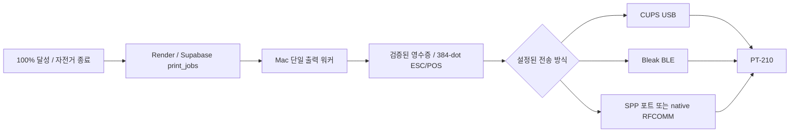

# PT-210 Bluetooth 조사 및 구현 설계

작성일: 2026-11-12 / 대상: 현재 행사장 Mac + ai-slop-stop 출력 워커

## 결론

현재 운영 코드는 USB CUPS 큐 `PT210_USB_BRIDGE`로만 전송한다. Bluetooth 출력 경로는 아직 없다. 기존 384-dot 흑백 렌더러와 ESC/POS 바이트 생성은 재사용하고, 전송 계층만 선택 가능하게 확장하는 방안을 권장한다.

보유 PT-210의 Bluetooth 프로파일은 아직 실물 확인 전이다. 같은 모델명의 다른 제품/펌웨어에서 BLE 또는 Classic SPP 구현 사례가 있다는 사실과, 지금 프린터가 이를 지원한다는 것은 구분해야 한다. `Bluetooth 4.x`, 모바일 앱 호환, USB 장치명만으로 BLE 지원 여부를 판정하지 않는다. 이번 조사에서는 제조사의 보유 기기와 정확히 일치하는 프로파일 명세를 확보하지 못했다.

실행 순서: **실물 프로파일 확인 → 가능한 전송으로 짧은 출력 → 실제 70~90KB 영수증 → 연속·절전·끊김 검증 → 운영 전환**. BLE만 된다고 확인되더라도 속도 검증 없이 기본 연결로 승격하지 않는다.

## 1. 현재 확인된 구성

| 항목 | 확인 내용 |
|---|---|
| 프린터 | 운영상 PT-210으로 사용, USB 식별은 `YC Printer demo` / VID 0x28e9 / PID 0x0289 |
| 인쇄 경로 | 자전거 종료 결과 저장 → 서버 print_jobs → Mac worker → CUPS USB → 프린터 |
| 렌더링 | Pillow, 폭 384 dots, 사진 Atkinson, `ESC *` 24-dot 밴드 |
| 전송 데이터 | 최근 실제 작업 약 70~90KB, 모든 텍스트도 이미지에 포함 |
| 중복 방지 | 서버 lease + 로컬 journal + 전송 시작 전 SENDING 기록 |
| SENT 의미 | CUPS 접수 완료. 종이 출력 완료를 보장하지 않음 |
| 장애 이력 | 시간값 렌더링 오류는 수정. USB 미인식 및 전송 오류 뒤 CUPS 일시중지도 관찰됨 |
| Bluetooth 확인 | 일반 장치 정보 조회만으로는 현재 연결 여부를 확정하지 못함. 검사 시 `/dev/cu.*`에는 프린터 시리얼 포트가 없었음 |

Bluetooth 전환은 USB 케이블·CUPS USB 백엔드 문제를 우회할 수 있지만, 프린터 배터리·절전·수신 버퍼·용지 문제까지 해결하지는 않는다. Bluetooth가 더 빠르다는 결론도 아직 없다.

## 2. 레퍼런스와 신뢰 범위

아래는 구현 주체가 직접 제공하는 자료를 중심으로 정리했다. 비공식 PT-210 SDK는 참고 구현이며 제조사 보증 자료가 아니다.

| 자료 | 확인한 내용 | 적용 시 제한 |
|---|---|---|
| [PT-210 비공식 SDK](https://goojprt-pt210-sdk.readthedocs.io/en/latest/) | BLE/SPP 드라이버 구조를 제공 | 보유 기기의 지원 증거로 사용하지 않음 |
| [SDK BLE 소스](https://goojprt-pt210-sdk.readthedocs.io/en/latest/_modules/goojprt/transport/ble.html) | 분할 전송·pacing·단일 writer 구조 | UUID와 전송 간격을 그대로 복제하지 않고 실측 |
| [SDK 전송 문서](https://goojprt-pt210-sdk.readthedocs.io/en/latest/api/transport.html) | BLE 및 Linux RFCOMM 구현, 분할·대기 파라미터 | 해당 SPP 코드가 Linux 전용이라는 의미. macOS 자체가 SPP 불가능하다는 뜻은 아님 |
| [Home Assistant Bluetooth ESC/POS 구현](https://github.com/dvbit/esc-pos-Bluetooth-printer) | 작성자가 PT-210 Classic RFCOMM/SPP 테스트를 보고 | 테스트 채널을 우리 기기에 고정하지 않음 |
| [Bleak macOS 문서](https://bleak.readthedocs.io/en/latest/backends/macos.html) | CoreBluetooth, Mac별 UUID 식별, 권한 및 pairing 동작 | Linux의 MAC 주소·pair 흐름과 다름 |
| [Bleak Client API](https://bleak.readthedocs.io/en/latest/api/client.html) | GATT 서비스 열거 및 쓰기 타입·최대 크기 | write 응답은 종이 출력 확인 응답이 아님 |
| [Apple RFCOMM API](https://developer.apple.com/documentation/iobluetooth/iobluetoothrfcommchannel) | macOS native RFCOMM 채널, 쓰기·연결 상태 API | 서비스 SDP 탐색, 권한, 실물 연결 구현 필요 |
| [Chrome Bluetooth Serial 공식 안내](https://developer.chrome.com/blog/serial-over-bluetooth/) | desktop Chrome에서 paired Classic RFCOMM 접근 | 사용자 포트 선택·브라우저 수명에 의존. 기존 자동 출력의 우선 경로로는 선정하지 않음 |

판매 페이지나 재편집 설명서의 Wi-Fi, PIN, 이름, 배터리, Bluetooth 버전은 이 설계의 확정 사양으로 채택하지 않았다. BLE 이름이나 FNB58 연결을 프린터 연결로 혼동하지 않는다.

## 3. 연결 방식별 결정

| 방식 | 선택 조건 | 권장 구현 | 우선순위 |
|---|---|---|---|
| BLE GATT | 실제 프린터에서 writable characteristic 발견 | Python 3.11 + Bleak, Mac 로컬 워커의 별도 async 전송 모듈 | 구현 PoC가 간단하므로 먼저 진단. 속도 기준 통과 시 채택 |
| Classic SPP, 시리얼 포트 노출 | macOS pairing 후 프린터 전용 `/dev/cu.*` 생성 확인 | pyserial adapter 또는 검증된 Bluetooth CUPS 큐 | 기존 워커 연동이 쉬운 조건부 경로 |
| Classic SPP, 시리얼 포트 없음 | SDP에서 SPP 서비스/RFCOMM 채널 확인 | macOS IOBluetooth native helper, MTU·flow-control 기반 전송 | BLE 미지원/느린 경우 유력 대안 |
| Classic SPP + 외부 로컬 호스트 | Mac native 경로가 검증되지 않거나 운영상 분리가 필요한 경우 | Linux 호스트의 RFCOMM worker | 추가 장비·운영 부담 때문에 후순위 |
| 브라우저 Web Serial | 운영자가 desktop Chrome에서 직접 포트 선택하는 별도 도구 필요 | 독립 진단·수동 테스트 페이지 | Vercel/iPad의 자동 출력 대체안으로 사용하지 않음 |

Mac에서 Python `socket.AF_BLUETOOTH`에 의존하는 Linux 예제를 바로 실행하는 방식은 선정하지 않는다. BLE 장치가 검색되지 않았다는 이유로 Classic 미지원이라고 판정하지 않는다. 별도 Bluetooth 송신기를 구입하기 전에 기존 Mac과 프린터의 프로파일을 확인한다.

## 4. 1차 실물 조사

1. 프린터 라벨·펌웨어·기기 자체 Bluetooth 정보에서 이름/프로파일 단서를 기록한다. 자체 테스트 페이지의 실행 방법은 보유 제품 설명서로 확인한다. PIN이나 버튼 조합을 추정해서 반복하지 않는다.
2. 프린터 전원을 켜고, 프린터를 점유 중인 휴대폰 인쇄 앱은 연결 해제한다.
3. 아래 BLE probe로 후보를 찾는다. 서비스 필터를 미리 고정하지 않아 광고에서 빠진 서비스를 누락시키지 않는다.
4. 선택한 후보만 서비스 열거한다. writable characteristic이 여러 개이면 모두 기록하고, 자동으로 첫 번째를 인쇄 포트로 선택하지 않는다.
5. BLE에서 확인되지 않으면 macOS Bluetooth에서 기기와 SPP 서비스 제공 여부를 확인한다. pairing 후 `/dev/cu.*`도 비교한다. 시리얼 포트가 없다고 실패로 단정하지 않고 native SDP 탐색으로 넘어간다.
6. 후보를 연결할 때 Mac의 Bluetooth 사용 권한이 필요하다. 묶음 앱은 `NSBluetoothAlwaysUsageDescription`을 설정하고, 실행 주체의 권한 상태를 확인한다. 이번 작업은 실제 Bluetooth 검색/접속·pairing·출력을 실행하지 않았다.

준비한 도구는 BLE 광고/서비스 열거만 수행하고, 인쇄·상태조회·설정 명령을 쓰지 않는다.

```sh
cd /Users/hunhokang/Downloads/esg_campaign/output/zeus-migration
/opt/homebrew/bin/python3.11 -m venv /private/tmp/pt210-bluetooth-venv
/private/tmp/pt210-bluetooth-venv/bin/pip install -r printer_bridge/requirements-bluetooth.txt
/private/tmp/pt210-bluetooth-venv/bin/python -m printer_bridge.bluetooth.probe --scan
/private/tmp/pt210-bluetooth-venv/bin/python -m printer_bridge.bluetooth.probe --inspect '스캔에서 확인한 UUID'
```

기본 검색은 프린터 이름 후보만 표시한다. 이름을 알 수 없는 기기는 `--scan --all`로 로컬에서 비교한다. UUID·쓰기 characteristic은 실물 확인 결과를 기록하며, 기기 이름·인터넷 예제의 UUID만으로 전송 대상은 확정하지 않는다. Mac BLE UUID는 다른 Mac에서 재사용 가능하다고 가정하지 않는다.

## 5. 통합 구조



`renderer.py`와 서버의 영수증 검증은 재사용한다. 전송 모듈만 분리한다. USB와 Bluetooth 워커를 동시에 같은 프린터에 연결하지 않고 기존 worker.lock과 job lease를 공유한다.

구현 예정 인터페이스:

```python
class PrintTransport:
    def preflight(self): ...
    def send(self, payload, progress): ...  # returns transport receipt; no implicit retry
    def close(self): ...
```

BLE 구현은 전용 event loop 한 개에서 연결을 유지하고 단일 writer로 직렬화한다. 작업마다 검색·접속·해제를 반복하는 방식은 시작 지연을 증가시키므로 운영 단계에서는 피한다. 스캔에서 얻은 BLEDevice 객체로 연결하며, 끊김 뒤 재검색·재연결은 다음 전송 시작 전에만 수행한다.

### 현재 코드에서 바꿔야 할 지점

| 파일/스키마 | 변경안 |
|---|---|
| `printer_bridge/worker.py` | `submit(path, queue)`를 transport dispatch로 분리, 전송 전 preflight, byte offset와 단계별 시간 기록 |
| 신규 `printer_bridge/transports/` | cups_usb / ble / 선택적 spp adapter |
| `printer_bridge/renderer.py` | 기존 ESC * 유지. GS v 0 등 다른 이미지 명령은 별도 실물 비교 후 선택 |
| `server/printing.py` | CUPS 전용 SENT 조건을 transport별 receipt 검증으로 확장 |
| `server/campaign.py` | 출력 상태 응답에 transport·전송/물리 확인 구분 추가 |
| DB migration | print_jobs에 transport, transport_job_id, bytes_submitted, transmission_complete 등 추가. cups_job_id는 CUPS에만 사용 |
| 설정·진단 UI | 연결 방식, 선택 기기, 연결 상태, 전송 중, 전송 불확실, 명시적 재출력 표시 |

현재 서버는 SENT 시 cups_job_id를 필수로 요구한다. BLE 장치 UUID를 여기에 가짜 CUPS ID로 넣는 편법은 사용하지 않는다. BLE는 CUPS와 다른 전송 식별자를 저장하고, 서버·DB가 이를 구분하도록 변경해야 한다. Bluetooth CUPS 큐를 실제로 만들 수 있는 환경에서는 기존 스키마를 유지할 수 있지만, 보유 Mac에서 가능한지 검증 전이다.

## 6. BLE 전송 규칙과 예상 속도

- 서비스/characteristic UUID와 지원 write 타입은 실물에서 확정한다. SDK의 primary/alternate UUID는 탐색 힌트일 뿐이다.
- write-with-response와 without-response를 명시적으로 선택한다. 후자는 OS 큐에 넣었다는 반환일 수 있으므로 성공 반환을 물리 출력 성공으로 해석하지 않는다.
- without-response의 한 번 쓰기 크기는 기기가 보고하는 `max_write_without_response_size`를 넘기지 않는다. 기본 20B가 보고되면 임의로 182/192B를 강제하지 않는다.
- chunk 간격·밴드 간격을 실제 영수증으로 튜닝한다. status 명령을 이미지 바이트 중간에 섞지 않는다.
- 처음부터 라이브러리의 이미지 변환까지 교체하지 않고 기존 byte stream을 전송한다. 전송 간격 때문에 다른 이미지 명령을 도입해야 한다면 현재 ESC *와 따로 검증한다.
- 토큰, 참가자 프롬프트, 전체 raw bytes는 진단 로그에 출력하지 않고 job ID·전송량·소요 시간만 기록한다.

SDK의 분할/간격 예제를 이용한 **전송만의 계산 예시**: 80KiB를 182B씩 40ms 간격으로 보내면 약 18초, 20B씩 같은 간격이면 약 164초다. 연결·프린터 모터·추가 throttle 시간은 제외한 값이며, 우리 기기의 실측 속도가 아니다. 따라서 현재처럼 텍스트까지 이미지인 영수증은 BLE에서 더 느릴 수 있다.

속도가 부족하면 순서대로 검토한다: 실제 허용 payload/간격 조정 → 긴 영수증 구성 축소 협의 → 검증된 GS v 0 등 명령 비교 → 지원 시 SPP/native RFCOMM 채택. 한글을 무조건 내장 문자로 바꾸면 글꼴·인코딩 호환성이 달라지므로 운영 출력 모양을 임의로 바꾸지 않는다.

## 7. 중복 출력 방지

현재의 보수적인 복구 원칙을 Bluetooth에서도 유지한다.

- PREPARED까지: 연결 확인/읽기 실패는 제한적으로 재시도 가능. 첫 write 전 실패만 확실하면 재준비 가능.
- 첫 write를 시도하기 **전**: 로컬 journal fsync 후 서버 SENDING 승인. 이후 데이터가 기기에 일부 도달했을 가능성이 생긴다.
- 전송 도중 끊김·타임아웃·프로세스 종료: UNKNOWN. 자동으로 처음부터 재전송하거나 USB로 우회 출력하지 않는다.
- 모든 write 반환: `transport_accepted` 또는 `bytes_submitted`로 기록. 프린터가 전체 데이터를 받았거나 종이가 완성됐다는 보장은 아니다.
- 인쇄 프로토콜의 기기 ACK가 실제로 검증됐을 때만 의미에 맞는 완료 상태를 추가한다. 상태 바이트의 PT-210 지원 여부도 실물 확인한다.
- 운영자가 실물·USB 큐·Bluetooth 연결 상태를 확인한 뒤 원래 작업과 연결된 재출력 작업을 명시적으로 한 번 생성한다.
- USB에서 Bluetooth로 전환할 때 기존 CUPS 큐의 잔여 작업을 먼저 확인한다. 남아 있는 작업을 Bluetooth로 복제하지 않는다.

## 8. 설정 제안

다음은 **앞으로 구현할 설정명**이며 현재 운영 워커가 이미 읽는 변수는 아니다.

```dotenv
PRINT_TRANSPORT=cups_usb
# BLE 실물 검증 후 선택
# PRINT_TRANSPORT=ble
# PRINT_BT_DEVICE_ID=<이 Mac에서 확인한 기기 UUID>
# PRINT_BT_WRITE_CHAR_UUID=<실물에서 확인한 characteristic UUID>
# PRINT_BT_WRITE_RESPONSE=<검증한 true 또는 false>
# PRINT_BT_CHUNK_BYTES=<협상 한도 이하 실측값>
# PRINT_BT_CHUNK_DELAY_MS=<실측값>
# PRINT_BT_CONNECT_TIMEOUT_SECONDS=15
# PRINT_BT_WRITE_TIMEOUT_SECONDS=10
```

초기 기본값은 기존 USB를 유지한다. 기기 식별자와 Bluetooth 설정은 행사장 Mac에 저장한다. 서버 인증 토큰을 브라우저·프린터·문서에 복사하지 않는다. Render/Vercel의 모델·인증 환경변수 변경은 필요하지 않다. 단, 직접 BLE 전송을 운영에 통합하는 단계에서는 앞서 설명한 서버/DB 상태 모델 배포가 필요하다.

## 9. 검증 및 전환 기준

아래 수치는 제안하는 합격 기준이며 아직 측정 결과가 아니다.

1. BLE/Classic 중 지원 프로파일, 선택 기기 식별자, 서비스/채널, 테스트 환경 기록.
2. 전원 재시작 없이 짧은 문자 2건, ESC * 이미지 2건 연속 출력.
3. 실제 크기 영수증 30건: 글자·QR·사진 누락/중복 0건. QR 3회 이상 판독.
4. idle 1/5/15분 뒤 출력 및 전원 재연결 테스트. 강제로 반복 인쇄해 복구하지 않음.
5. FNB58 BLE 측정과 동시에 운용: 측정 누락·연결 해제·인쇄 지연을 각각 확인. 같은 Mac Bluetooth 자원 경쟁을 포함.
6. 1/3/5m 거리에서 연결 성공률과 첫 출력·마지막 출력 시간을 기록. 운영 배치 거리는 결과로 확정.
7. 중간 Bluetooth 차단: UNKNOWN으로 끝나고 자동 재출력이 없는지 확인.
8. USB fallback을 명시적으로 선택해도 기존 큐 작업과 중복되지 않는지 확인.
9. 지속 연결 시 데이터 준비 완료→첫 종이 이동 p95 3초 이내를 잠정 목표로 설정. 전체 영수증 완료 시간은 USB 기준과 같은 양식으로 비교하고, 더 느리면 개선 폭과 무선 필요성을 운영자가 판단.

**일정 추정**: 프로파일 확인/짧은 PoC 반나절, 전송 adapter·상태 스키마 1~2일, 현장 장애/절전/연속 시험 1일. Classic native helper가 필요하면 별도 개발·검증이 추가된다. 실물 프로파일 미확정 상태의 가정에 따른 추정이며 확정 일정이 아니다.

## 10. 이번 작업 완료 범위

- 현재 USB 구현 경로 확인, Bluetooth 레퍼런스 비교, macOS 구현 경로 및 중복 방지 설계 완료.
- 선택 기기의 BLE 광고/서비스를 확인할 수 있는 **비출력 진단 도구**와 mock 테스트 4개 작성·통과.
- 실제 기기 Bluetooth 지원/UUID/채널·속도는 미확정. 실제 scan, pairing, Bluetooth 테스트 출력, 운영 전송 변경, 서버/DB migration은 실행하지 않았다.
- 다음 작업은 프린터 실물을 켜둔 상태에서 BLE 진단과 Classic SDP 확인을 수행해 전송 방식을 결정하는 것이다.
